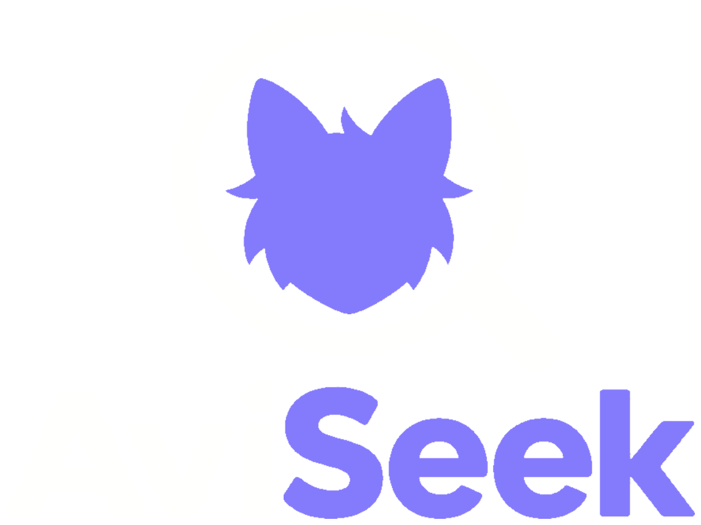
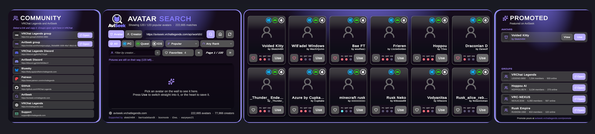
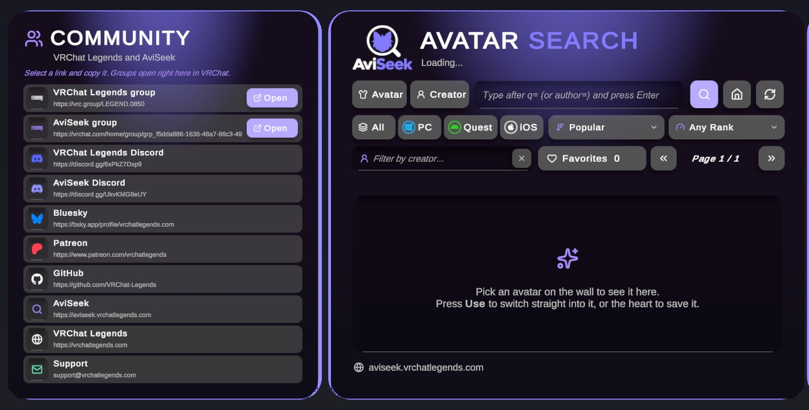
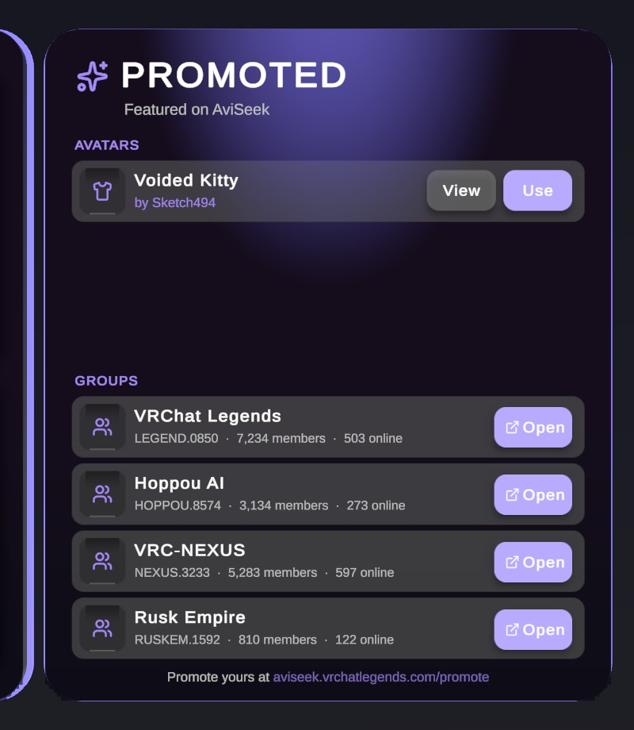

<p align="center">
  
</p>

<h1 align="center">AviSeek World SDK</h1>

<p align="center">
  A drag and drop avatar search wall for VRChat worlds, powered by <a href="https://aviseek.vrchatlegends.com">AviSeek</a>.
</p>

<p align="center">
  <a href="https://vrchat-legends.github.io/Aviseek-SDK/"><b>Add to VRChat Creator Companion</b></a>
  &nbsp;·&nbsp;
  <a href="https://github.com/VRChat-Legends/Aviseek-SDK/releases/latest">Latest release</a>
  &nbsp;·&nbsp;
  <a href="https://discord.gg/UkvKMG8eUY">Discord</a>
</p>



Players search more than 200,000 public avatars by name or creator, filter by platform and performance rank, save favorites and folders to their AviSeek account (shared with the website and every AviSeek world), browse promoted avatars and groups, and switch avatars in one click. VR players can press it like a touch screen. No API key is needed, and players only need an AviSeek account to save favorites.

## Install

### VRChat Creator Companion

1. Open the [listing page](https://vrchat-legends.github.io/Aviseek-SDK/) and press **Add to VRChat Creator Companion**.
   Or, in the Creator Companion, go to **Settings > Packages > Add Repository** and paste:
   ```
   https://vrchat-legends.github.io/Aviseek-SDK/index.json
   ```
2. Open your world with **Manage Project** and add **AviSeek World SDK**.

### By hand

Download `com.vrchatlegends.aviseek-world-x.y.z.zip` from the [latest release](https://github.com/VRChat-Legends/Aviseek-SDK/releases/latest) and unzip it into `Packages/com.vrchatlegends.aviseek-world` in your project. The `.unitypackage` from the same release works too.

## Add the wall

In Unity, open **AviSeek > SDK Panel**. The Setup tab checks your scene and adds the wall where the Scene view is looking. You can also drag `Packages/AviSeek World SDK/Runtime/Prefabs/AviSeek Avatar Search.prefab` into the scene. Turn the wall to face your spawn.



| Panel | What it does |
| --- | --- |
| Supporters | The AviSeek supporters, each tier on its own pages in its own colour, with a link players can copy to become one. |
| Socials | Your community links. Players copy a link, and VRChat groups open in game. |
| Search | Avatar or creator search, platform tabs, sort, rank filter, creator filter, favorites and paging. |
| Results | Twelve avatar cards with VRChat's own pictures, Windows, Android and Apple ratings, a heart and a Use button. |
| Folders | The player's AviSeek folders, the same as on the website: show one on the wall, fill it, make or delete folders. |
| Promoted | Avatars and groups promoted on AviSeek, any number of them, a page at a time. |
| Mirror | A mirror with Off, Players and Full buttons, picked by each player for themselves. |
| Store | Off by default. Your own VRChat Creator Economy products, with Get buttons, Owned badges and perks for owners. |

## Make it yours

Select the wall, or use the Branding tab of the SDK Panel:

- Title, highlighted word, logo and accent colour, shown on the wall as you change them.
- Switch the Supporters, Socials, Folders, Mirror, Promoted and Store panels on or off. The other panels close up to fit. There is no back wall, so hang them on any wall in your world.
- Switch the touch screen on or off.
- Select **Socials Panel** to edit, add, reorder or remove links.
- Select **Store Panel** to add your Creator Economy products.



See the [package README](Packages/com.vrchatlegends.aviseek-world/README.md) for every detail, and the [changelog](Packages/com.vrchatlegends.aviseek-world/CHANGELOG.md) for what is new.

## This repository

This repo follows VRChat's [package template](https://github.com/vrchat-community/template-package).

| Path | What it is |
| --- | --- |
| `Packages/com.vrchatlegends.aviseek-world` | The package itself. |
| `Website` | The listing page, built by the listing workflow. |
| `source.json` | The VPM listing settings. |
| `.github/workflows/release.yml` | **Build Release**: zips the package, makes a `.unitypackage` and publishes a GitHub release tagged with the package version. |
| `.github/workflows/build-listing.yml` | **Build Repo Listing**: rebuilds `index.json` and the website from the releases and deploys them to GitHub Pages. |

### Releasing a new version

1. Bump `version` in `Packages/com.vrchatlegends.aviseek-world/package.json` and add a section to `CHANGELOG.md`.
2. Push to `main`.
3. Run **Build Release** from the Actions tab. When it finishes, **Build Repo Listing** runs on its own and the Creator Companion sees the update.

To work on the package, open this folder as a Unity 2022.3 project through the Creator Companion, or open it in the Unity Hub and let the bootstrapper fetch the VRChat SDK.

## Community

- [VRChat Legends group](https://vrc.group/LEGEND.0850) and [AviSeek group](https://vrchat.com/home/group/grp_f5dda886-1636-46a7-86c3-49256fab4fc6)
- [VRChat Legends Discord](https://discord.gg/6xPkZ7Dxp9) and [AviSeek Discord](https://discord.gg/UkvKMG8eUY)
- [Bluesky](https://bsky.app/profile/vrchatlegends.com), [Patreon](https://www.patreon.com/vrchatlegends), [GitHub](https://github.com/VRChat-Legends)
- [aviseek.vrchatlegends.com](https://aviseek.vrchatlegends.com) and [vrchatlegends.com](https://vrchatlegends.com)
- Support: support@vrchatlegends.com

## License

The code is under the [MIT License](LICENSE). The AviSeek and VRChat Legends names and logos belong to VRChat Legends. The avatar index is powered by [VRC-NEXUS](https://search.vrc-nexus.online). Icons come from [Lucide](https://lucide.dev) (ISC) and [Simple Icons](https://simpleicons.org) (CC0), the text font is [Inter](https://github.com/rsms/inter) (OFL), the touch sounds are [Kenney UI Audio](https://kenney.nl/assets/ui-audio) (CC0), and the platform badges from the VRChat Wiki. See [THIRD_PARTY_NOTICES.md](Packages/com.vrchatlegends.aviseek-world/THIRD_PARTY_NOTICES.md). Not affiliated with VRChat Inc.
